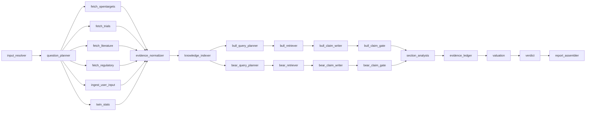
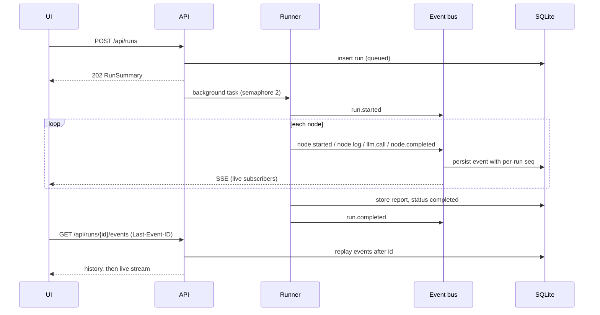

# Architecture

Drug-program underwriting for Secrethon 2026 (Unobio track). Input: indication plus mechanism or target, with
optional drug, modality, stage, preclinical results, notes and links. Output: **Invest / Conditional / Do Not Invest**
and a report where every claim drills down Recommendation → Claims → Evidence → Sources. The unit of analysis is the
drug program, never the company.

Status legend: **[1a]** exists in the contract PR, **[1b]** lands in the walking-skeleton PR, **[later]** is planned.

## 1. Principles

- Bounded retrieval from known public APIs. Evidence is fetched once, then reasoning works on that frozen set.
- Fixed schemas, full provenance, and a gate that rejects claims whose evidence ids do not exist in the run.
- Claim labels: `extracted | derived | inferred | modeled | hypothesis | unknown`. Model background knowledge may only
  appear as `hypothesis`. Unknown is a valid answer; empty beats wrong.
- Ranges, not false precision. Every number is sourced or a labelled assumption.

## 2. Graph topology [1a]

The shape lives in `backend/app/graph/topology.py`; node specs live next to their code.

25 nodes in `GET /api/graph`: 17 from the product table plus 8 bull/bear inner nodes. `bull_case` and `bear_case` are
**containers**: spec-only nodes that group their four inner nodes in the UI (`parent` field). They have no `run`.

## 3. Implementing a node [1a]

Every node module exposes a module-level `SPEC: NodeSpec` and `async def run(state, ctx) -> dict` that returns a state
delta. Node ids, function names and `NodeSpec`s are part of the contract.

- `ctx.llm` is effort-aware. `ctx.effort` carries knobs (retrieval k, number of queries, max tokens).
- `ctx.retriever.retrieve(query, entity_ids, stance, k)` is bound to the run: only evidence in the run's set, minus
  evidence excluded by corrections in the lineage.
- `ctx.register_sources(...)` / `ctx.register_evidence(...)` persist records. The runner adds the returned ids to
  `source_ids` / `evidence_ids` in the node's delta.
- `ctx.corrections_for(node_id)` returns user corrections for the node anywhere in the run lineage. Inner nodes of a
  container also see corrections attached to the container.
- `ctx.log(...)` and `ctx.progress(...)` stream to the UI. Nodes never touch the event bus, DB sessions or OpenAI.
- `scratch: dict[node_id, dict]` in state carries hand-offs that are not part of the report (raw fetch refs, drafted
  claims, index stats). Keep state small: bodies live in the store, state carries ids and compact objects.
- Bull/bear inner nodes come from `nodes/subgraphs/bull_bear.py`: one implementation, instantiated per stance.

Failure policy [1b]: a failing non-critical node is marked `failed`, writes empty outputs, and the run continues.
`input_resolver`, `verdict` and `report_assembler` are critical and fail the run. Nodes must tolerate empty upstream
outputs.

## 4. State [1a]

`GraphState` (TypedDict, `backend/app/graph/state.py`) holds typed contract models. Parallel writers use reducers
(`source_ids`, `evidence_ids` union; `claims`, `sections`, `scratch` dict merge). `dump_delta` / `load_delta`
round-trip a delta through JSON, which is what replay stores.

## 5. Run lifecycle [1b]

Every event is persisted first and published second, so a late or reconnecting subscriber replays the full history
from the database and then follows live. Heartbeat every 15 s; the stream closes on `run.completed` or `run.failed`.

## 6. Corrections: replay, not checkpoint forking [1b]

- The affected set is the corrected node plus every descendant. A container expands to all its inner nodes.
- Non-correctable nodes (`evidence_normalizer`, `knowledge_indexer`, `report_assembler`) still re-run when they are
  descendants of a correction.
- Corrections accumulate along the lineage. A child of a child sees both.
- Sources and evidence use content-hash ids and are stored globally, so parent and child share rows. A run's evidence
  set is the list of ids in its state; the retriever filters by that set, so a child never pollutes its parent.
- `ReportDiff` compares any two runs of a lineage: decision, PoS, changed sections, added/removed claims, recomputed nodes.

## 7. Effort and panel [1b]

`config/effort.yaml` maps `low | medium | high | panel` to a model tier plus knobs. The model defaults to the cheapest
available. In panel mode, analysis nodes run N completions in parallel (different models if `panel_models`, else one
model with varied temperature), then one comparator call merges them into a parsed output plus a `PanelResult`.
Panel never applies to data, processing or quant nodes. In 1b panel is an interface plus a mock; real logic is later.

## 8. Caching [1b]

- **Source cache**: official API responses, TTL `CACHE_TTL_DAYS` (default 7). Bypassed on `force_refresh` or when the
  user adds new information.
- **LLM cache**: key = sha256(model, messages, schema name, params), stored in SQLite `llm_cache`. On in dev
  (`LLM_CACHE=1`).

## 9. Storage [1b]

SQLite at `backend/data/app.db` via SQLAlchemy 2 async, `create_all` at startup, no migrations. Tables: `runs` (with
report JSON), `run_events`, `node_executions` (compact output for the UI plus the full state delta for replay),
`corrections`, `llm_calls`, `llm_cache`, `source_cache`, `sources`, `evidence`, `kg_nodes`, `kg_edges`. Vectors live
in LanceDB under `backend/data/vectors` [later]. `backend/data/` is git-ignored.

## 10. Provenance rules

- Every claim cites evidence ids that exist in the run; the claim gate rejects or downgrades the rest, keeping the
  rejected claim visible with a `rejection_reason`.
- Ledger steps and valuation assumptions are `sourced` (with a citation) or `assumption`. The models enforce
  "sourced needs a citation".
- Assumptions live in `backend/config/*.yaml` with a `citation` or `assumption: true`.
- Fixtures contain no invented facts: placeholders are prefixed `FIXTURE:` and use example.org. The only real
  identifiers are ClinicalTrials.gov `NCT01739348` and `NCT01953601` (verubecestat, Alzheimer's, TERMINATED).

## 11. Cost model

Cost per call = tokens × registry price (`config/models.yaml`). Prices are unknown for now, so `cost_usd` is `None` and
tokens are always logged. Guards: `MAX_RUN_COST_USD` (when prices are known) and `MAX_RUN_TOKENS` (always). Before each
call the guard first downgrades panel to single, then skips the node fail-soft with reason `budget`. The team budget is
$67 including development, so deliverable numbers come from a few real `live` runs with the cache on.

## 12. Ownership

| Area | Owner |
|---|---|
| `frontend/**` | Person A |
| `backend/app/api/**`, `graph/**`, `llm/**`, `core/**`, `report_assembler` node | Person A |
| `backend/app/sources/**`, `store/**` (except run/event/correction/LLM repos), `quant/**`, other `nodes/**` bodies, `backend/scripts/*opentargets*`, `backend/scripts/explore_*`, `docs/data/**` | Person B |
| `backend/app/contracts/**`, `contracts/**`, `nodes/base.py`, node names and specs, `backend/config/*.yaml` keys | Shared, via `contract/...` PR |

## 13. Contract change protocol

1. Branch `contract/<topic>`; touch only contracts, fixtures and regenerated types.
2. `make types` regenerates `contracts/openapi.json` and `frontend/src/api/types.gen.ts` (never hand-edit the latter);
   `make graph-spec` regenerates the graph fixture.
3. Fixtures must still validate (`make check`); `types-check` fails on stale generated files.
4. Both humans approve.

## 14. Decisions log

- **Replay, not checkpoint forking.** A correction creates a child run that re-executes only the affected set and
  reuses stored deltas elsewhere. Forking LangGraph checkpoints would need to handle parallel branches and
  subgraphs; replay is deterministic, inspectable in the DB, and gives `node.reused` events for free.
- **Flat bull/bear.** The four inner nodes per stance are added to the one `StateGraph` by a shared builder instead of
  compiling nested subgraphs. Nested subgraphs complicate per-node events, `NodeExecution` records and inner-node
  replay.
- **`asyncio.gather` instead of `Send` for section analysts.** `Send` creates N invocations of one node id, which muddies
  events and replay. One node, one record, per-section progress. `Send` remains possible later.
- **SQLite + LanceDB.** Zero-ops, file based, enough for a hackathon and a single-box demo.
- **APIs, not scrapers.** Official APIs behind `sources/` with a cache; a scraper only for a real gap with approval.
- **Mock-first LLM.** `LLM_MODE=mock` gives deterministic zero-cost output for development and tests. Deliverables
  (demo, cost per run, README numbers) come from `live` runs.
- **Fail-soft nodes.** One flaky source or model call should degrade a section, not kill a demo.
- **Content-hash ids.** Sources, evidence and claims get stable ids from their content, so runs share rows and
  corrected runs diff cleanly.
- **Response schemas fully required.** The OpenAPI export marks every field of non-request models required, so the
  generated TS types do not force `?.` on fields the server always sends.
