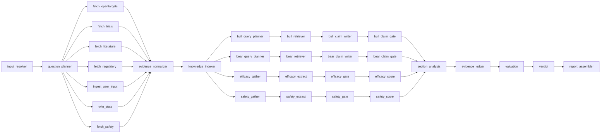
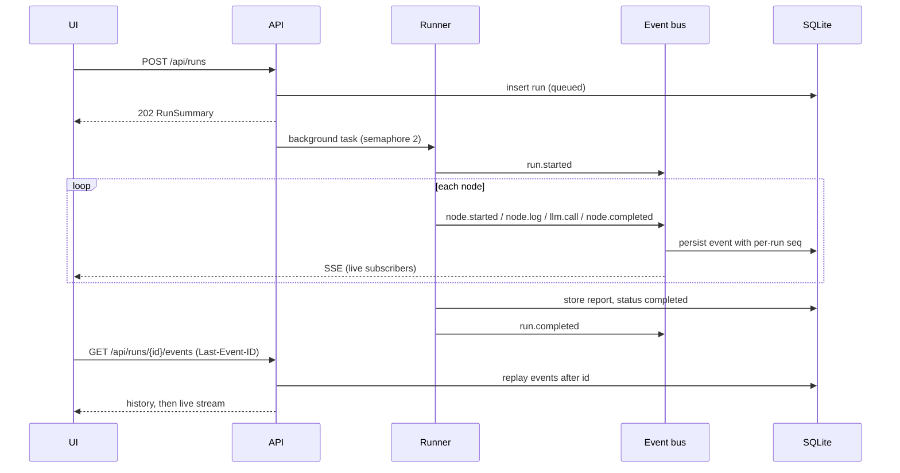
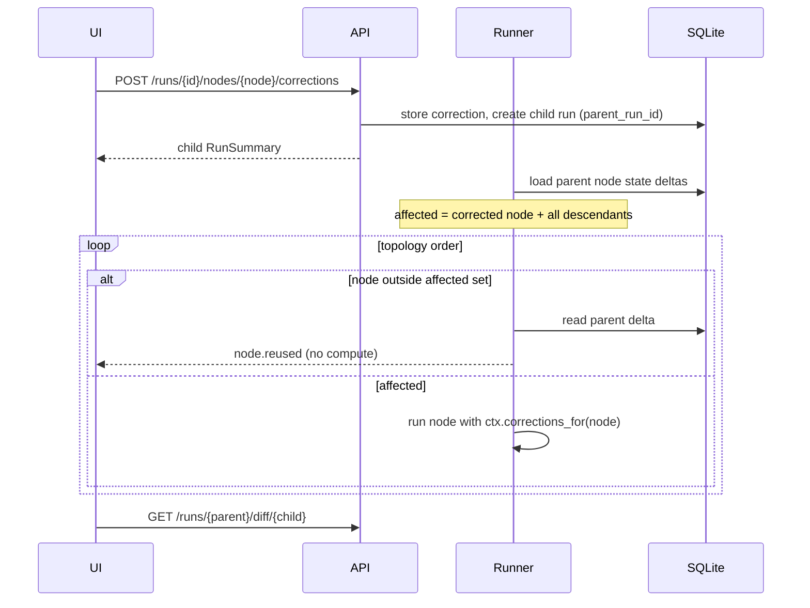

# Architecture

Drug-program underwriting for Secrethon 2026 (Unobio track). Input: indication plus mechanism or target, with
optional drug, modality, stage, preclinical results, notes and links. Output: **Invest / Conditional / Do Not Invest**
and a report where every claim drills down Recommendation → Claims → Evidence → Sources. The unit of analysis is the
drug program, never the company.

Status legend: **[1a]** contracts and skeleton, **[1b]** walking skeleton (both shipped), **[later]** planned. Node bodies other
than `report_assembler` are still fixture-driven stubs until Person B replaces them; everything around them is real.

## 1. Principles

- Bounded retrieval from known public APIs. Evidence is fetched once, then reasoning works on that frozen set.
- Fixed schemas, full provenance, and a gate that rejects claims whose evidence ids do not exist in the run.
- Claim labels: `extracted | derived | inferred | modeled | hypothesis | unknown`. Model background knowledge may only
  appear as `hypothesis`. Unknown is a valid answer; empty beats wrong.
- Ranges, not false precision. Every number is sourced or a labelled assumption.

## 2. Graph topology [1a]

The shape lives in `backend/app/graph/topology.py`; node specs live next to their code.

36 nodes in `GET /api/graph`, 32 of them runnable: 18 top-level steps plus 4 inner nodes for each of the bull case, the
bear case and the efficacy and safety lanes. `bull_case`, `bear_case`, `efficacy_assessment` and `safety_assessment`
are **containers**: spec-only nodes that group their four inner nodes in the UI (`parent` field). They have no `run`.

### 2a. Efficacy and safety lanes [1a contract, later bodies]

Industry data (ASBMB Today, citing a 2016 analysis it does not name) puts the reasons programs stop at roughly 40-50%
lack of efficacy, 30% unmanageable toxicity, 10-15% poor drug-like properties (exposure) and 10% commercial or
strategic. The old graph had no step that asked the two biggest questions directly. Each lane is the same four steps:

| Step | Kind | Does |
|---|---|---|
| `<lane>_gather` | knowledge, code | Pulls what bears on this cause from the frozen evidence and the precedent base (section 2c): association evidence by data type, same-target trial outcomes, class history, tissue expression, label warnings, safety-tagged stop reasons. No model. |
| `<lane>_extract` | analysis, **one model call** | Reads the gathered material and writes claims (and, for efficacy, the five-step translation chain). Every claim cites evidence ids. |
| `<lane>_gate` | processing, code | `gate_claims` as for the cases; writes the accepted `claims` and `translation_chain`. |
| `<lane>_score` | quant, code | Turns the gathered numbers and the accepted claims into `RiskAdjustment`s and an `AssessmentResult` (rating, headline, metrics, gaps). Formulas only. |

The efficacy lane speaks to the `efficacy` and `pk_exposure` causes, the safety lane to `safety`. `fetch_safety` (target
liabilities, tissue expression, label warnings, adverse-event counts) is a new data source feeding the safety lane, and
`question_planner` asks a safety question. The model reads and writes; every number comes from a function.

### 2b. The evidence ledger is a cause-specific hazard ledger [1a contract, later bodies]

The old ledger multiplied odds by likelihood ratios, which treats every piece of evidence as if it moved all of the
risk. The new one splits risk by cause (`backend/app/quant/hazard.py` is the reference implementation, with tests).

1. Prior `p` (from twin stats). Cumulative hazard `H = -ln p`.
2. Split `H` by the failure mix: `H_i = share_i * H`. The mix comes from the twins' own stop reasons when at least
   `failure_mix.min_stopped_twins` stopped, otherwise from the literature split in `config/ledger.yaml`
   (`FailureMix.source` says which, with the citation).
3. A `RiskAdjustment` multiplies one cause's hazard: `H_i <- H_i * risk_ratio`. Below 1 lowers that risk, above 1 raises it.
4. `posterior = exp(-sum(H_i))`, clamped to `posterior_clamp`.

Each `LedgerStep` carries its `cause`, its `risk_ratio` and the running `pos_after`, so the UI draws a waterfall without
doing any maths. `EvidenceLedger.by_cause` shows how each cause's hazard moved. The low end of a probability range is the
pessimistic end (lower prior, higher ratios); hazards and ratios run the other way. The order of adjustments does not
change the posterior, only the picture of the steps.

### 2c. Two knowledge stores [later]

Today `knowledge_indexer` builds a word-overlap vector index (a stand-in for LanceDB) and a trivial graph (disease, target
and drug nodes with `mentioned_in` edges to every source); the retrievers ignore the graph. The plan is two stores with
different jobs, not one graph:

| Store | Scope | Built | Used by |
|---|---|---|---|
| Evidence graph | one run | by `knowledge_indexer`, in code, from normalised evidence: typed nodes (target, disease, drug, trial, tissue, adverse event) and typed edges (`associated_with`, `expressed_in`, `tested_in`, `stopped_for`), each pointing at evidence ids | `*_gather` and the retrievers, to answer "what do we know about this target in this tissue" without reading everything |
| Precedent base | global, read-only | offline, by a script, from Open Targets bulk data into DuckDB tables: `clinical_report`, `clinical_indication`, `clinical_target`, `target_safety_event`, with stop reasons categorised safety / efficacy / business / other | `twin_stats`, `efficacy_gather`, `safety_gather`: same-target and same-class history and the failure mix |

The precedent base is what gives the lanes "similar drugs that came before"; it is shipped as a file and never written
during a run. The evidence graph is optional for the demo; the precedent base is not.

## 3. Implementing a node [1a]

Every node module exposes a module-level `SPEC: NodeSpec` and `async def run(state, ctx) -> dict` that returns a state
delta. Node ids, function names and `NodeSpec`s are part of the contract.

- `ctx.llm` is effort-aware. `ctx.effort` carries knobs (retrieval k, number of queries, max tokens).
- `ctx.retriever.retrieve(query, entity_ids, stance, k)` is bound to the run: only evidence in the run's set, minus
  evidence excluded by corrections in the lineage.
- `ctx.register_sources(...)` / `ctx.register_evidence(...)` persist records. The runner adds the returned ids to
  `source_ids` / `evidence_ids` in the node's delta.
- `ctx.corrections_for(node_id)` returns user corrections for the node anywhere in the run lineage. Inner nodes of a
  container also see corrections attached to the container.
- `ctx.log(...)` and `ctx.progress(...)` stream to the UI. Nodes never touch the event bus, DB sessions or OpenAI.
- `scratch: dict[node_id, dict]` in state carries hand-offs that are not part of the report (raw fetch refs, drafted
  claims, index stats). Keep state small: bodies live in the store, state carries ids and compact objects.
- Bull/bear inner nodes come from `nodes/subgraphs/bull_bear.py`: one implementation, instantiated per stance.

Failure policy [1b]: a failing non-critical node is marked `failed`, writes empty outputs, and the run continues.
`input_resolver`, `verdict` and `report_assembler` are critical and fail the run. Nodes must tolerate empty upstream
outputs.

## 4. State [1a]

`GraphState` (TypedDict, `backend/app/graph/state.py`) holds typed contract models. Parallel writers use reducers
(`source_ids`, `evidence_ids` union; `claims`, `sections`, `scratch`, `risk_adjustments` and `assessments` dict merge).
`risk_adjustments` is keyed `cause:factor` and written by the lane `score` nodes; `assessments` is keyed by cause. `dump_delta` / `load_delta`
round-trip a delta through JSON, which is what replay stores.

## 5. Run lifecycle [1b]

`emit` is synchronous: it assigns the per-run `seq`, publishes to live subscribers in call order, and queues the event for a
single writer that commits in order. A subscriber registers first, then reads history: every event is either already in
SQLite, in the snapshot of not-yet-committed events taken at subscribe time, or arrives on its queue, so a late or
reconnecting client sees everything exactly once. `Last-Event-ID` resumes after that seq. Heartbeat every 15 s; the
stream closes on `run.completed` or `run.failed`, or immediately when the client resumes past the end of a finished run.
Runs left `queued` or `running` by a crash are marked failed at startup and get a terminal event.

## 6. Corrections: replay, not checkpoint forking [1b]

- The affected set is the corrected node plus every descendant. A container expands to all its inner nodes.
- Non-correctable nodes (`evidence_normalizer`, `knowledge_indexer`, `report_assembler`) still re-run when they are
  descendants of a correction.
- Corrections accumulate along the lineage. A child of a child sees both.
- Sources and evidence use content-hash ids and are stored globally, so parent and child share rows. A run's evidence
  set is the list of ids in its state; the retriever filters by that set, so a child never pollutes its parent.
- `ReportDiff` compares any two runs of a lineage: decision, PoS, changed sections, added/removed claims, recomputed nodes.

## 6b. API [1b]

All under `/api`. Errors share one shape, `{"error": {"code", "message", "details": [{"path", "message", "type"}]}}`.

| Method | Path | Returns |
|---|---|---|
| GET | `/health`, `/models`, `/graph` | status and mode flags; `ModelInfo[]`; `GraphSpec` |
| POST | `/runs` | `RunSummary` (202) |
| GET | `/runs?limit=`, `/runs/{id}` | `RunSummary[]`; `RunDetail` (node list without logs and LLM calls) |
| GET | `/runs/{id}/events` | SSE of `RunEvent`; `id:` is the seq |
| GET | `/runs/{id}/report`, `/runs/{id}/nodes/{node}` | `UnderwritingReport`; full `NodeExecution` |
| POST | `/runs/{id}/nodes/{node}/corrections` | child `RunSummary` (202); 409 unless the parent completed, 422 if not correctable |
| GET | `/runs/{id}/diff/{other}` | `ReportDiff` going from `id` to `other`; 400 across lineages |
| GET | `/runs/{id}/trace` | JSON download: run, lineage, corrections, events, node executions, LLM calls |
| GET | `/evidence/{id}` | `EvidenceDetail` (evidence plus its source) |
| POST | `/runs/{id}/summary` | the plain-language read-out of a completed run (`ChatMessage` with cited claim ids). Written once and stored in `run_summaries`; asking again returns the same text. 409 until the run completed |
| GET | `/runs/{id}/messages` | chat history of the run, oldest first |
| POST | `/runs/{id}/messages` | follow-up question (`role: user`, 1–2000 chars); returns the assistant `ChatMessage`. 409 until the run completed, 422 on a bad message, 429 after `MAX_CHAT_QUESTIONS`, 502 `chat_failed` if the model reply is unreadable |

### Follow-up chat

`backend/app/chat/`. `context.py` renders the finished report as plain text: verdict, reasons, up to 60 non-rejected
claims (accepted first) with two evidence excerpts each, sections, twins, ledger and valuation, capped at 14k characters.
`answer.py` asks the model for `{supported, answer, cited_claim_ids}`. The question and history go in the user message as
data; the system prompt says to use only the report text. `gate_answer` drops cited ids that are not in the context, and an
answer marked supported with no valid citation is replaced by a fixed refusal, so the chat never states what it cannot tie
to a claim. In `mock` mode the answer is canned from the verdict's reason claims. Live calls are logged to `llm_calls` with
node id `chat`, so they count in the trace and cost.

`summary.py` writes the briefing that sits under a finished run: a compact Markdown report of 400 to 650 words (Verdict, Why this
call, What the report found with one subsection per report section, Funding to the next milestone, Risks and unknowns, What
to do next). Each statement carries inline `[[claim_id]]` marks. The gate strikes marks whose id is not a usable claim, numbers
the rest by first use (`cited_claim_ids` is that order), and a briefing that cites nothing real is replaced by
`template_summary`, which composes the same structure from the report's own verdict, sections, valuation, risks and
diligence questions with no model call. One model call per run, logged under node id `summary`. The frontend asks for it when
the run completes; the endpoint is idempotent, so a reload shows the stored text.

## 7. Effort and panel [1b]

`config/effort.yaml` maps `low | medium | high | panel` to a model tier plus knobs. The model defaults to the cheapest
available. In panel mode, analysis nodes run N completions in parallel (different models if `panel_models`, else one
model with varied temperature), then one comparator call merges them into a parsed output plus a `PanelResult`.
Panel never applies to data, processing or quant nodes. In 1b panel is an interface plus a mock; real logic is later.

## 8. Caching [1b]

- **Source cache**: official API responses, TTL `CACHE_TTL_DAYS` (default 7). Bypassed on `force_refresh` or when the
  user adds new information.
- **LLM cache**: key = sha256(model, messages, schema name, params), stored in SQLite `llm_cache`. On in dev
  (`LLM_CACHE=1`).

## 9. Storage [1b]

SQLite at `backend/data/app.db` via SQLAlchemy 2 async, `create_all` at startup, no migrations. Tables: `runs` (with
report JSON), `run_events`, `node_executions` (compact output for the UI plus the full state delta for replay),
`corrections`, `chat_messages`, `run_summaries`, `llm_calls`, `llm_cache`. Person B adds `source_cache`, `sources`, `evidence`, `kg_nodes`, `kg_edges` with the
real stores; until then `store/fakes.py` keeps them in memory (so `/evidence/{id}` only knows evidence from the running
process). Vectors live in LanceDB under `backend/data/vectors` [later]. `backend/data/` is git-ignored.

## 9b. Frontend [1b]

The header, footer and home page are a copy of unobio.com (`frontend/src/unobio/`, assets in `frontend/public/unobio/`): its
compiled CSS scoped under one `.ub-site` class so it cannot clash with our Tailwind, its fonts and images, its
server-rendered markup converted to JSX, and a port of its three behaviours (scroll reveal, hero parallax, header blur
after scrolling). Every link and button is inert (no `href`); the exceptions are "Gravity" in the header, which opens
`/underwriting`, and the header logo, which goes home. The chat page has the copied header and no footer (`GravityShell`), so the workspace fills the viewport; only the home page shows the footer. The copied
files are artifacts of the live site, so avoid hand-editing `HomeSections.tsx`, `HeroAssets.tsx` and `FooterMarkup.tsx`;
Tailwind is told to ignore `src/unobio` (`@source not`). The cookie banner is not copied.

Motion (`styles/motion.css`) is arrival-only and short: the history sidebar slides (by width on desktop, by translate as a
drawer on phones, `inert` while closed); the view area grows its width from the right edge while the conversation shrinks
with it, and the dock inside keeps one fixed pixel width so the views are laid out once and only revealed (below 1280 px it
slides in as an overlay; dragging the splitter turns the easing off so it follows the pointer); "Add details" opens through
`uw-collapse` (grid rows with an even ease, content fading in a beat later) and the welcome screen is anchored from the
top so the heading does not move as it grows; the effort picker is four equal columns with one highlight that slides to the chosen level; new
thread content, history rows and the finished call rise or flash once (`uw-rise`, `uw-fade`, `uw-flash`, `uw-ring`,
`uw-stagger` for the briefing). Nothing loops. `prefers-reduced-motion` removes all of it, and printing does too.

The graph folds its 32 steps into the pipeline phases (`graph/groups.ts`: every phase with two or more executing steps is a
group, so Gather public evidence, Freeze and index, Check efficacy and safety, Argue both sides and Quantify and decide), which
leaves nine boxes: a column with the assess and cases groups side by side, because they run in parallel. A folded group is one larger box with its progress ("2/7 steps", and which steps are running); clicking it unfolds
it, and clicking the title of an unfolded frame folds it again. Edges are rewired onto the boxes (no self-links, no
duplicates), a group that holds a failed or running step shows that status, and a correction draft rings every group it
would recompute. Group all and Ungroup all sit beside the legend, and the arrangement is remembered
(`uw.graphCollapsed`). Unfolding is a dissolve: the steps start at the box and glide to their places (CSS transitions on
the node wrappers) while the box fades, and once the steps have left it the camera centres on the group that was just unfolded (zoom at most 1.1) and then counts as the
reader's, so a resize leaves it alone; Group all and Ungroup all refit the whole graph unless the reader panned or zoomed. Box names
are centred; the status icon is balanced by a hidden spacer so the name itself sits at the centre.
Nodes are always handed to React Flow in one fixed order, because React moving a node in the list restarts its style and
the transition never plays.

Layout is dagre for ranks and order, with the rest done in `graph/layout.ts`: each frame reserves room above its first
step and below its last, a fork's branches start on the same row, and every wire is routed square through the gaps
between rows, so no wire crosses a step or a frame title (`layout.test.ts` checks this for all 32 fold states). A frame
with a single way in has its title chip on that wire; a frame with several puts the chip where none enters. Wires carry
the run: grey while waiting, inked once the step before them has finished, dashed and moving while the step after them
runs, red when a step failed, dashed blue when reused (`graph/wires.ts`, `styles/graph.css`).

In a panel-mode run the graph draws the panel (`graph/panel.ts`). Every step that makes a model call (kind `analysis`, the
same rule the backend uses to run a panel) gets the run's panel size of small "Analyst" steps in a row before it, and the
step itself is renamed "Aggregator" and keeps its id, so its status, drawer and corrections stay the step's own; its detail
line names the step it aggregates for. An analyst opens that step's drawer. The analysts' status mirrors the step's: the
backend reports one call per panel, not one per candidate. A step whose log says panel mode is unavailable stays single.

The workspace (`features/underwriting/`) is laid out like a chat app. `Sidebar` lists earlier runs, grouped by correction
lineage (one entry with v1, v2 … links). The middle column is the conversation: a new chat (`Welcome`: greeting, the big
`Composer`) or a run, shown as pipeline phases (`phases.ts` groups the 32 steps into nine collapsible
blocks), folded into one line by default: while the run goes it names the step in progress (`currentStep`, e.g. "Gather public
evidence: openFDA, Europe PMC"), and "Show steps" opens the list (`WorkTrace`). When the run completes, the briefing
(`SummaryBlock`: Markdown through `react-markdown`, raw HTML never rendered, `[[id]]` marks drawn as numbered buttons that
open the claim, and a "Claims cited" list) and a compact verdict card follow, then the follow-up thread (`FollowUpMessages`) with its reply box
(`FollowUpInput`) docked at the bottom; both read `useFollowUp`, which is backed by the chat endpoints (history is loaded
per run; a 429 locks the box with a note). `TopBar` has toggle buttons for the four views. Each view is a panel of a dock (`dock/`, on `dockview-react`): the reader can
drag a tab to reorder it, drop it on the edge of another panel to split beside or under it, or float it, and drag the bar
between the conversation and the dock to resize (arrow keys work on the bar too). The views read the run through
`ViewDataContext`; `ViewContent` draws the content of one view with no frame. On a run page the arrangement is saved to
localStorage (`uw.dock.v1`, read back only if `parseLayout` finds it names our four views) and restored on the next run;
below 1280 px the dock covers the conversation. A correction or a version switch passes the view to open in router state.
Printing hides every group but the one holding the report (`print.css`). The graph refits when its panel changes size,
until the reader pans or zooms. The report view
is the report as a tree you open as far as you want (`report/reportTree.ts`, `report/tree/`): the call at the root (decision,
probability, value at stake, what carries it and what holds it back), under it the four questions an investor asks (will it
work in people, get through trials and regulators, be used, is funding it worth it), each with a standing, how much it moved
the probability, a for/against scale, and, side by side from the first look, its heaviest claims for (green, plus) and against
(red, minus), the same colours everywhere; opened, every claim, then its efficacy or safety check, risks and what could not be
established; a claim opens to its evidence and sources. A strip of the four questions sits in the root as a map, and each card
has a left edge in its standing's colour. The tree is derived from the report as it is (claim
stance and section, the ledger's steps by cause, the checks), adds nothing, and prints whole. Under it, a closed "Full
report" keeps every section, chart and claim. A link to a claim opens the branch it sits in. Also in the view: a "What
changed" banner for corrected runs, SVG twin, ledger-waterfall, valuation and translation visuals, Markdown export, print;
the graph (kind
colours, follow mode, a tabbed step drawer, highlighting of what a correction would recompute), sources and logs. Pure
logic lives in plain `.ts` modules with vitest tests (`phases`, `claimFilters`, `diffView`, `waterfall`, `twinView`, `reportTree`,
`markdown`, `correctionTarget`, `logView`, `sourcesView`, `elapsed`). The mock API takes `?scenario=` for messy data.

Vite, React, TanStack Query, `@xyflow/react` with dagre. `src/api/client.ts` is a typed `fetch` and `EventSource` wrapper over
the generated types. With `VITE_API_MODE=mock` it loads `src/api/mock/`, which replays the fixture events with delays and
builds corrected runs the same way the backend does, so the whole UI works with no server. Run state is a reducer over
`RunEvent`s (`features/underwriting/reduceEvents.ts`): the chat steps, graph status rings and log timeline are all views of
it, and a page reload rebuilds them by replaying the stream. The report drill-down (claim, evidence, source) reads from the
report itself.

`components/glyph-field` draws a flowing field of colour as text, in two WebGL2 passes: a domain-warped noise field at half
resolution, stretched upward so it rises like flame, then one letter per cell (DNA bases A T C G plus `/` and `\`) chosen by
the cell's darkness with a random per-cell threshold, so letters of one density mix like a read sequence, over the soft
field. The pointer pushes the field; reduced motion gives one still frame; without WebGL2 it draws nothing. It is written
from scratch (not Unicorn Studio's scene) and is previewed at `/lab/glyph-field`, which nothing links to. The `mist` preset
(pale blue into grey, strokes only lighter than the ground, slow, shy of the pointer, with `detail` 3.2 so the same colours
change often, over short stretches, down the panel) sits behind the history sidebar; its
darkest stop is the worst case for text over it and a test holds that at 4.5:1 for muted text. Behind another panel, such as
the graph, spread `PRESETS.mist` the same way and keep what sits on it opaque or lighter than the stops.
The history rows are frosted glass over it (`styles/glass.css`): the picked row a strong, blue-tinted blur that stays, a hovered
row a whiter, more opaque blur; neither has an outline, the blur, tint and soft shadow are the edge; both are lighter than the field, so text only gains contrast, and reduced transparency turns the
blur off. There is no arrival flash on the row, because an animated background hides the glass while it runs.

## 9c. Implementing and testing a node [1b]

1. Edit the node module; keep `SPEC` and the `run(state, ctx)` signature. Return only keys listed in `SPEC.writes`
   (anything else fails the node). Register sources and evidence through `ctx`, not by returning ids.
2. Gate every claim with `graph/provenance.gate_claims(claims, valid_evidence_ids)`; the assembler re-checks as a safety net.
3. Run it: `make dev`, or in tests `create_run(services, program, options)` then `await manager.wait_idle()`
   (see `backend/tests/test_runner_events.py`). `LLM_MODE=mock` and `STUB_DELAY_SCALE=0` make runs instant and free.
4. `nodes/_fixture.py` and the fixture-derived bodies of the stubs are scaffolding; delete what you replace.

## 10. Provenance rules

- Every claim cites evidence ids that exist in the run; the claim gate rejects or downgrades the rest, keeping the
  rejected claim visible with a `rejection_reason`.
- Ledger steps, risk adjustments, assessment metrics, the failure mix and valuation assumptions are `sourced` (with a
  citation) or `assumption`. The models enforce "sourced needs a citation".
- The two lanes run in parallel, so a risk adjustment or assessment may cite only claims written by its own lane's
  extractor, or evidence ids. Citing the bull or bear case would point at claims that may not exist yet when the lane
  scores; an adjustment that had support and lost all of it to a correction is dropped.
- Assumptions live in `backend/config/*.yaml` with a `citation` or `assumption: true`.
- Fixtures contain no invented facts: placeholders are prefixed `FIXTURE:` and use example.org. The only real
  identifiers are ClinicalTrials.gov `NCT01739348` and `NCT01953601` (verubecestat, Alzheimer's, TERMINATED).

## 11. Cost model

Cost per call = tokens × registry price (`config/models.yaml`). Prices are unknown for now, so `cost_usd` is `None` and
tokens are always logged. Guards: `MAX_RUN_COST_USD` (when prices are known) and `MAX_RUN_TOKENS` (always). Before each
call the guard first downgrades panel to single, then skips the node fail-soft with reason `budget`. The team budget is
$67 including development, so deliverable numbers come from a few real `live` runs with the cache on.

Added by the efficacy and safety lanes (estimate, not measured): one model call per lane, each reading a gathered digest
rather than raw evidence, roughly 17k extra tokens per run in total. There is no separate judging call: `section_analysts`
reads `assessments` and weighs them. Gathering and scoring are code and cost nothing.

## 12. Ownership

| Area | Owner |
|---|---|
| `frontend/**` | Person A |
| `backend/app/api/**`, `graph/**`, `llm/**`, `core/**`, `report_assembler` node | Person A |
| `backend/app/sources/**`, `store/**` (except run/event/correction/LLM repos), `quant/**`, other `nodes/**` bodies, `backend/scripts/*opentargets*`, `backend/scripts/explore_*`, `docs/data/**` | Person B |
| `backend/app/contracts/**`, `contracts/**`, `nodes/base.py`, node names and specs, `backend/config/*.yaml` keys | Shared, via `contract/...` PR |

## 13. Contract change protocol

1. Branch `contract/<topic>`; touch only contracts, fixtures and regenerated types.
2. `make types` regenerates `contracts/openapi.json` and `frontend/src/api/types.gen.ts` (never hand-edit the latter);
   `make graph-spec` regenerates the graph fixture.
3. Fixtures must still validate (`make check`); `types-check` fails on stale generated files.
4. Both humans approve.

## 14. Decisions log

- **Cause-specific hazards, not odds ratios.** Evidence about toxicity should not move the efficacy risk. Splitting the
  prior's cumulative hazard by failure cause makes each adjustment local, order-independent and explainable per cause, and
  the failure mix is a citable number (ASBMB Today, primary study unverified) until twin stats have enough stopped trials.
- **Model reads, code computes.** In the lanes the model only extracts claims; ratings and risk ratios come from formulas
  over the gathered numbers, so the numbers are reproducible, cheap and not a model's opinion.
- **Old stored runs are upgraded on read, not migrated.** A contract change must not make earlier chats unreadable. Reports and
  stored node deltas are passed through `core/legacy_report.py` when loaded, which today turns the old ledger step (a
  likelihood ratio on odds) into the cause-specific one; the database is never rewritten. A change that cannot be upgraded
  that way needs a note in its contract PR.
- **Replay, not checkpoint forking.** A correction creates a child run that re-executes only the affected set and
  reuses stored deltas elsewhere. Forking LangGraph checkpoints would need to handle parallel branches and
  subgraphs; replay is deterministic, inspectable in the DB, and gives `node.reused` events for free.
- **Flat bull/bear.** The four inner nodes per stance are added to the one `StateGraph` by a shared builder instead of
  compiling nested subgraphs. Nested subgraphs complicate per-node events, `NodeExecution` records and inner-node
  replay.
- **`asyncio.gather` instead of `Send` for section analysts.** `Send` creates N invocations of one node id, which muddies
  events and replay. One node, one record, per-section progress. `Send` remains possible later.
- **SQLite + LanceDB.** Zero-ops, file based, enough for a hackathon and a single-box demo.
- **APIs, not scrapers.** Official APIs behind `sources/` with a cache; a scraper only for a real gap with approval.
- **Mock-first LLM.** `LLM_MODE=mock` gives deterministic zero-cost output for development and tests. Deliverables
  (demo, cost per run, README numbers) come from `live` runs.
- **Fail-soft nodes.** One flaky source or model call should degrade a section, not kill a demo.
- **Copied site styles are scoped, not shared.** unobio.com ships Tailwind v3 output; ours is Tailwind v4. Prefixing every
  selector of the copied CSS with `.ub-site` (html and body rules map to the wrapper itself) and keeping our UI outside that
  wrapper means neither stylesheet can restyle the other, while the copy stays pixel-identical (verified by screenshot diff
  against the live page at desktop and mobile widths).
- **`scratch` for hand-offs.** Data that moves between nodes but is not part of the report (raw fetch refs, drafted claims,
  index stats) lives in `state["scratch"][node_id]`, so nodes need no extra state keys.
- **Report meta is finalised by the runner.** `report_assembler` builds the report; tokens, cost, timing, cache hits and failed
  nodes are only known once the run ends, so the runner fills them in. `synthetic` is set by the assembler whenever any
  claim text or source title starts with `FIXTURE:`.
- **Tests inject the OpenAI SDK's own transport.** The installed SDK ships its own http layer (`httpx2`), which `respx` does not
  patch, so live-backend tests pass an `httpx2.MockTransport` as `http_client`.
- **Content-hash ids.** Sources, evidence and claims get stable ids from their content, so runs share rows and
  corrected runs diff cleanly.
- **Response schemas fully required.** The OpenAPI export marks every field of non-request models required, so the
  generated TS types do not force `?.` on fields the server always sends.
